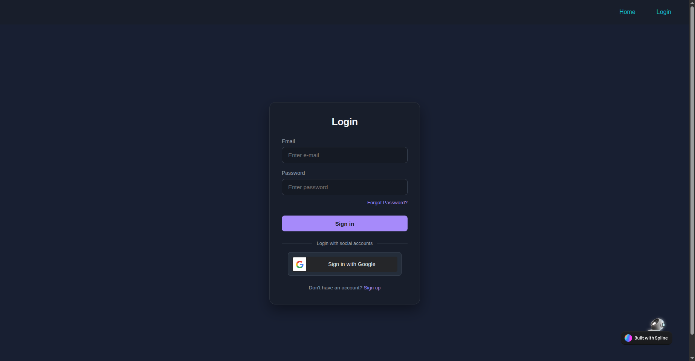
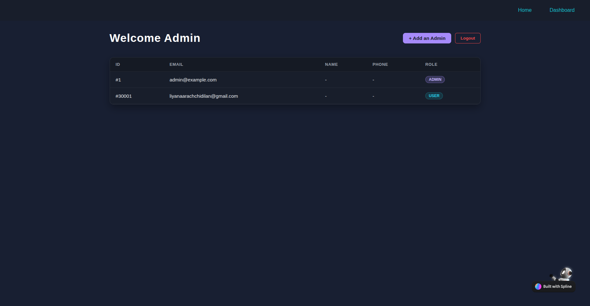
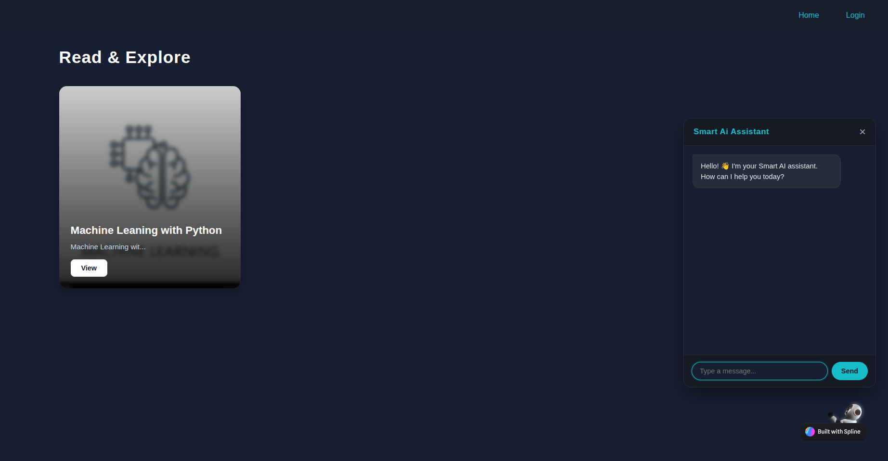

# 📝 Full-Stack Blog Posting Platform — Frontend

A lightweight, high-performance, and fully responsive Single-Page Application (SPA) engineered with Vanilla JavaScript, HTML5, and modern CSS3. This client connects seamlessly to a secure RESTful API backend, supporting role-based access, JWT authentication, and interactive content authoring.

---

## 🚀 Live Demo & Documentation

* **Live Frontend Application:** [Blog Platform on GitHub Pages](https://uddeepika-liyanaarachchi-prodoscore.github.io/Blog-posting-platform-Front-End/)
* **Backend API & Postman Workspace:** [Postman API Collection](https://uddeepika-liyanaarachchi-193515.postman.co/workspace/Uddeepika-Liyanaarachchi's-Work~bdd6d74e-1bef-405f-8eaf-02edd21e9cf7/collection/58486206-aafedfa5-d73a-422e-bfe6-b801ecec5902?action=share&creator=58486206)

---

## 📸 Application Preview & Screenshots

| Authentication Screen | User Dashboard |
| :---: | :---: |
| <br><sub>**Secure Authentication & Session Setup**</sub> | <br><sub>**Reader View & User Feed**</sub> |

| Admin Management Panel | AI Assistant & Content Generation |
| :---: | :---: |
| <br><sub>**Role-Based Administration & Moderation**</sub> | <br><sub>**AI Writing Assistant & Optimization**</sub> |

---

## ✨ Key Features

* **SPA Navigation & Client Routing:** Seamless screen transitions without page reloads using browser history manipulation.
* **Role-Based Authentication (RBAC):** Distinct workflows, dashboards, and capabilities for regular users and administrators.
* **Secure JWT Session Management:** Persistent login state managed via secure storage with token-bearer request interceptors.
* **Full CRUD Operations:** Create, update, preview, publish, and delete blog posts with real-time UI synchronization.
* **AI Integration:** Integrated AI features to assist authors with automated content generation, drafting, and tagging.
* **Responsive UI Design:** Accessible across desktop, tablet, and mobile browsers using responsive CSS Grid and Flexbox.
* **Automated CI/CD Pipeline:** Fully automated deployments to GitHub Pages on every release, coupled with downstream QA test hooks.

---

## 🛠️ Tech Stack

* **Front-End Core:** Vanilla JavaScript (ES6+), HTML5, CSS3
* **Network & API:** Native Fetch API, Asynchronous Promises, RESTful JSON
* **Deployment & Hosting:** GitHub Pages
* **Automation & CI/CD:** GitHub Actions
* **Version Control:** Git & GitHub

---

## 📂 Project Structure

```text
├── assets/
│   ├── css/
│   │   ├── style.css          # Global styling & layout
│   │   ├── auth.css           # Login & registration views
│   │   └── dashboard.css      # User & Admin console interfaces
│   ├── js/
│   │   ├── api.js             # Base HTTP client & fetch wrappers
│   │   ├── auth.js            # JWT handlers, tokens & user state
│   │   ├── router.js          # SPA route interception & view rendering
│   │   └── main.js            # Core event listeners & DOM handlers
│   └── images/
│       ├── login.png          # Authentication preview screenshot
│       ├── admin.png          # Admin management view screenshot
│       ├── user.png           # User portal view screenshot
│       └── ai.png             # AI assistant preview screenshot
├── pages/                     # Sub-views or partial HTML templates
├── index.html                 # Main Single-Page entry point
└── README.md
``` 

## 🔄 CI/CD & Automated QA Integration
Continuous Deployment: Merging or pushing to main runs a GitHub Actions workflow that bundles assets and deploys directly to GitHub Pages.

Automated E2E Testing: Deployments trigger a repository_dispatch event that fires the downstream QA Selenium Automation Suite targeting the live production URL.

## 📄 License
Distributed under the MIT License.